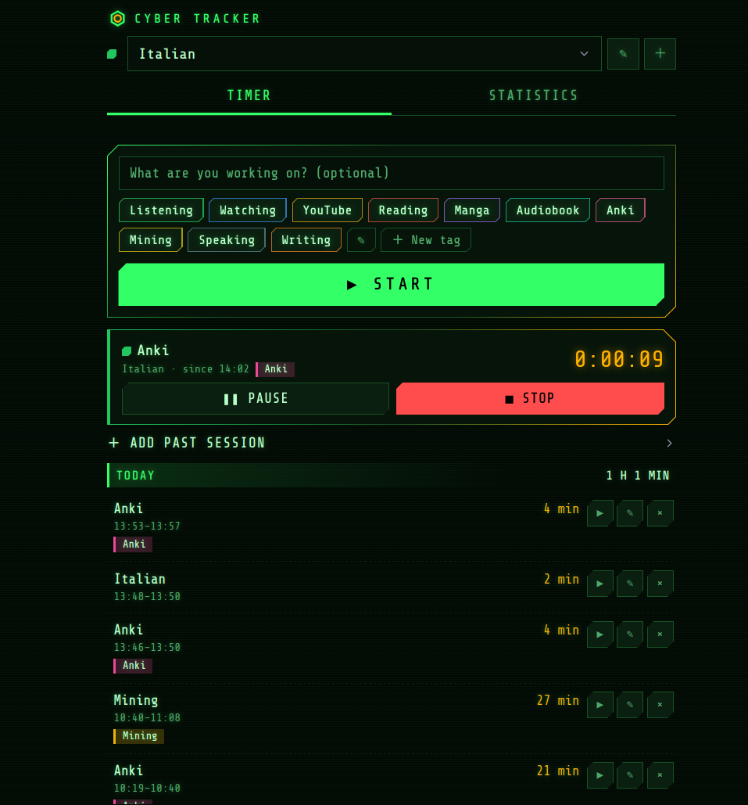
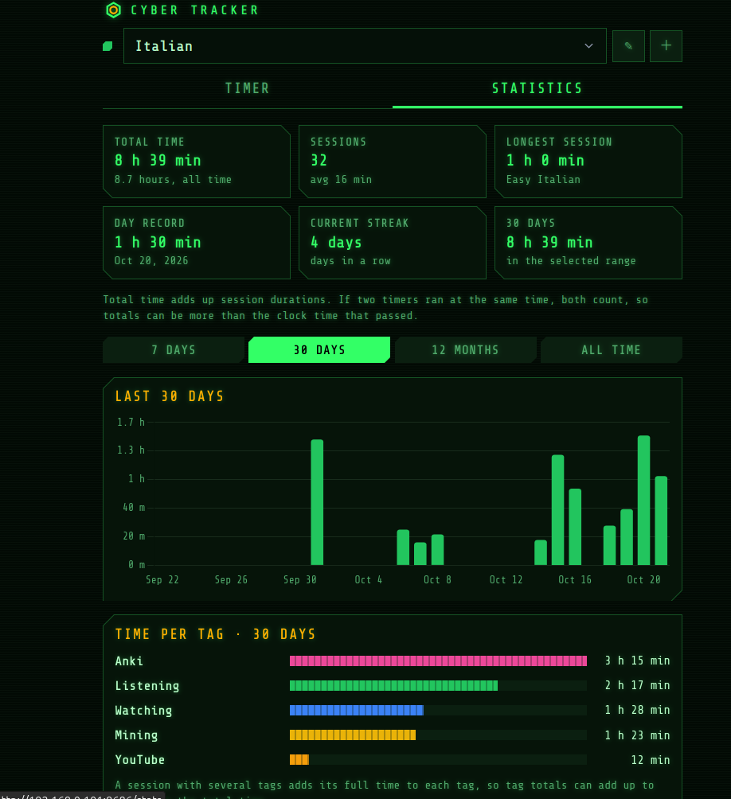
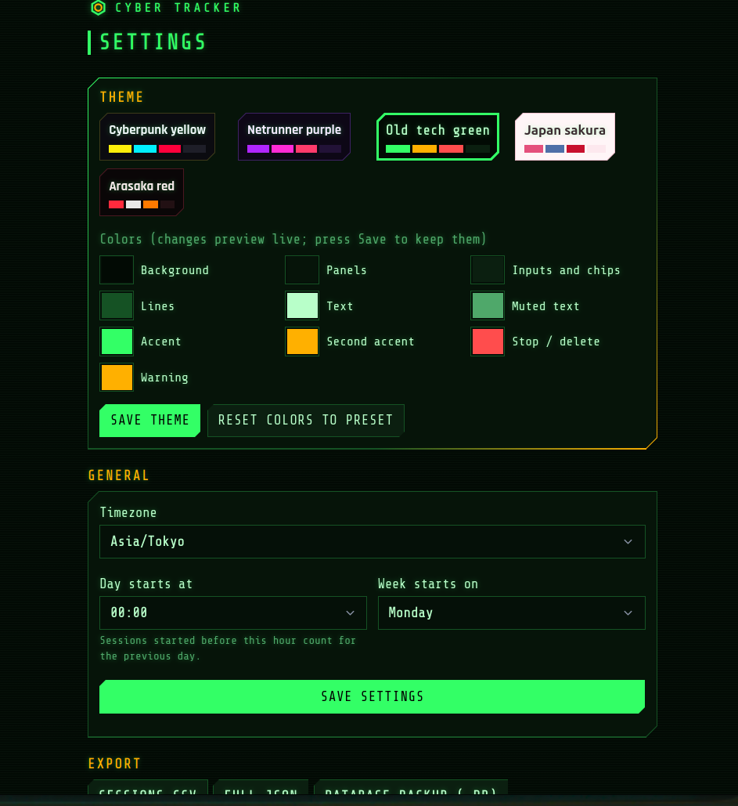

[English](README.md) | **日本語**

# ⌬ Cyber Tracker

趣味や学習（語学、絵、プログラミングなど何でも）に使った時間を記録する、セルフホスト型の Web アプリです。Raspberry Pi 上の小さな Docker コンテナ 1 つで動き、家のネットワーク内のスマホやノート PC から開けます。標準の見た目はサイバーパンク 2077 風のゲーム UI で、ほかに 4 つのテーマと自分好みの色も選べます。



- **タイマー**：プロジェクトを選び、タグをタップして Start。複数のタイマーをプロジェクトをまたいで同時に動かせます。一時停止、再開、停止、やり直し、編集、元に戻せる削除。過去のセッションも手で追加できます。
- **統計**：合計時間、セッション数、最長セッション、1 日の最高記録、連続日数、1 日の目標線付きの棒グラフ（7 日、30 日、12 か月、全期間）、タグ別の時間、1 年分のヒートマップ。
- **プロジェクト**（語学・アート・プログラミング用の初期タグ付き）、**アイデア**（自分用の機能要望リスト）、**設定**（タイムゾーン、1 日の始まりの時刻、テーマと色、CSV/JSON エクスポート、JSON インポート、データベースのバックアップ）。
- **テーマ**：Cyberpunk yellow（標準）、Netrunner purple、Old tech green、Japan sakura、Arasaka red。[テーマ](#テーマ)を参照。
- PWA としてインストール可能。ログイン不要、クラウド不要、インターネット不要：JS、CSS、フォントはすべて `app/static/vendor/` に同梱しています。
- **⌬ Cyber Miner**：同じデザインの Chrome 拡張機能。YouTube と Netflix の字幕から Anki の例文カードを作り、視聴時間と作ったカード数をこのアプリに記録します。[Cyber Miner](#-cyber-miner-chrome-拡張機能) を参照。



構成：Python 3.13、FastAPI、SQLModel、SQLite（WAL）、Alembic、Jinja2、HTMX 2、Alpine.js 3、Chart.js 4、Pico.css 2、augmented-ui 2、フォントは Rajdhani と Share Tech Mono。Node もビルド手順も不要です。設計：[docs/DESIGN.md](docs/DESIGN.md)。開発中に決めたこと：[docs/DECISIONS.md](docs/DECISIONS.md)。Chrome 拡張機能の設計：[docs/EXTENSION_DESIGN.md](docs/EXTENSION_DESIGN.md)。（docs は英語のみ）

## ⌬ Cyber Miner (Chrome 拡張機能)

同じデザインの Chrome 拡張機能で、[`extension/`](extension/README.ja.md) にあります。**YouTube** と **Netflix** の字幕から **Anki** の例文カードを作り、視聴時間と作ったカード数を Cyber Tracker に記録します。対応言語は日本語、中国語（簡体字）、イタリア語で、英語の翻訳の行が付きます。


**字幕バー**
- 字幕の行を動画の上の独自のバーに表示し、その下に英語の行を出します。英語の行はホバーするまでぼかす・常に表示・非表示を選べます（オプション、または Alt+S）。
- 単語をクリックするとその単語でカードを作ります。ドラッグで文字をそのまま選び、⌬ で行全体を使います。
- A / D で行を移動、Alt+R でもう一度再生。
- バーを 0.4 秒長押しすると動画内の好きな場所へ動かせ、⟲ で元に戻ります。
- 小さなプレーヤー、シアターモード、全画面のどれでも収まります。
- **覚えた単語**：Anki のデッキをもとに単語に色を付けます（Anki にない・学習中・覚えた）。すでにカードがある単語はサイドパネルで警告します。

**サイドパネルのカード編集**
- **画像**：動画のフレーム。
- **音声**：その行を MP3 で録音し、専用のプレーヤーで聞けます。
- **区間**：開始や終了を 0.5 秒ずつずらしたり、前 / 次の行を加えたりでき、録音し直します。
- **単語**：選んだ単語をハイライトした文と、オフライン辞書の結果：
  - 日本語：JMdict（読み、ピッチアクセント、活用形からの原形検索）。
  - 中国語：CC-CEDICT（ピンイン）。
  - イタリア語：Wiktionary（活用形）。
- AnkiConnect 経由で **Send to Anki**（Ctrl+Enter）。重複を知らせ、Anki が閉じているときはカードを保存しておきます。
- **クイック作成**（Alt+Shift+M）はパネルを開かずに送ります。

<p align="center"></p>

**字幕一覧**
- サイドパネルの Transcript タブに動画のすべての行を表示し、再生位置に追従します。
- 行をクリックでその場面へ、⌬ でその行のカードを作ります。
- 単語はバーと同じく色分けされ、行ごとの新しい単語の数と、新しい単語のある行だけを表示するフィルターがあります。
- Shift+クリックで複数の行を選び、1 枚のカードにできます。

<p align="center"></p>

**Anki のカード**
- 専用のノートタイプ **Cyber Sentence** で、言語ごとにデッキを分け、トラッカーと同じデザインです。
- 単語をハイライトした文、翻訳、音声、画像。
- ふりがなとピッチアクセントの図、意味付きの単語。
- 動画のその場面へのリンク付きの出典。


**Netflix**
- 同じバーと編集画面が使えます。
- 字幕は Netflix のトラック一覧から取り、音声の言語でトラックを選びます。
- 画像は映像部分に切り抜いたスクリーンショットです（オプションで一度だけ許可）。
- 音声は Chrome の「このタブを共有」から、タブごとに一度だけ許可します。


**視聴時間とポップアップ**
- 日本語・中国語・イタリア語のトラックがある動画は、その言語のプロジェクトの視聴セッションとして Cyber Tracker に記録され、「Watching」と「YouTube」/「Netflix」のタグが付きます。
- 動画の一時停止中と広告中は止まります。作ったカード数は統計画面に表示されます。
- ポップアップに出るもの：
  - Anki とトラッカーの接続状態；
  - このタブのセッション；
  - 今日のカード数；
  - 「Don't track this tab」。

<p align="center"></p>

**オプション**
- Anki の接続、デッキとノートタイプの準備。
- 言語と翻訳の行。
- 辞書のインポート。
- カードの音声と画像の設定。
- トラッカーのアドレスと言語ごとのプロジェクト。
- テーマ：Cyber Tracker の現在のテーマか、プリセットに合わせます。

<p align="center"></p>

セットアップ（Chrome、AnkiConnect、辞書、トラッカー、Netflix）、すべてのショートカットキー、今後の予定：[extension/README.ja.md](extension/README.ja.md)。

## uvicorn でローカル実行

Python 3.13 が必要です（[uv](https://docs.astral.sh/uv/) なら `uv venv --python 3.13` で自動で取得します）。

```bash
uv venv --python 3.13 .venv
uv pip install --python .venv -r requirements-dev.txt
.venv/bin/uvicorn app.main:app --host 127.0.0.1 --port 8686
```

http://127.0.0.1:8686 を開きます。データベースは `./data/tracker.db` に作られ、起動時にマイグレーションが実行されます。コマンドの前に `SEED_DEMO=1` を付けると、デモ用のプロジェクト 3 つとセッション 40 件が入ります（プロジェクトがまだ無いときのみ）。

`requirements.txt` は実行に必要なもの、`requirements-dev.txt` はそれにテスト用ツールを加えたものです。テストの実行：

```bash
.venv/bin/pytest -q
```

## Docker Compose で実行

```bash
cp .env.example .env      # optional: port, timezone, host user id
docker compose up -d --build
```

http://localhost:8686 を開きます。データはホストの `./data/tracker.db`（`./data:/data` ボリューム）に保存されるので、再起動・再ビルド・イメージ更新をしても残ります。

```bash
docker compose logs -f              # follow the logs
docker compose ps                   # shows "healthy" once the app answers
docker compose restart
docker compose down                 # stop (data stays in ./data)
```

コンテナの設定内容：

- root ではなくホストのユーザーで動きます（`.env` の `PUID`/`PGID`、標準は 1000）。そのため `./data` 内のファイルは自分のものになります。
- uvicorn のワーカーは 1 つ（SQLite の書き込みは 1 つずつで、メモリも少なく済みます）。リクエストごとのアクセスログは出さず、Docker のログは 3 × 1 MB までに制限しているので、SD カードが少しずつ埋まることはありません。
- `restart: unless-stopped`、60 秒ごとの `/api/health` ヘルスチェック、きれいに終了するための `init: true`、256 MB のメモリ上限（アプリの使用量は約 80〜120 MB）。
- プラットフォーム指定なし：同じ Dockerfile で x86_64、arm64（64 ビット Raspberry Pi OS）、armv7（32 ビット Raspberry Pi OS）向けにビルドできます。

古い root 実行のコンテナが `./data` を作っていた場合は、一度だけ所有者を直します：`sudo chown -R "$(id -u):$(id -g)" data`。

## Raspberry Pi 3 にデプロイ

Pi 3（RAM 1 GB）で十分快適に動きます。Pi 4 や 5 でも手順は同じです。

### 1. Pi の準備

1. Raspberry Pi Imager で **Raspberry Pi OS Lite (64-bit)** を書き込みます。Imager の設定でホスト名（例：`cyberpi`）、ユーザー、必要なら Wi-Fi を設定し、SSH を有効にします。
   64 ビット版を使ってください：32 ビット版 Raspberry Pi OS に対応する Docker Engine は 28 が最後です。どうしても 32 ビットのままにしたい場合も、イメージは 32 ビット（armv7）向けにビルドできます。
2. 起動してログイン：`ssh <user>@cyberpi.local`。
3. 更新：`sudo apt update && sudo apt full-upgrade -y && sudo reboot`。
4. ルーターで Pi に固定 IP（DHCP 予約）を割り当てます（例：`192.168.0.50`）。こうするとアプリのアドレスが変わりません。

### 2. スクリプトでインストール（おすすめ）

```bash
sudo apt install -y git
git clone https://github.com/JarvisSan22/Cyber-timetracker.git ~/cyber-tracker
cd ~/cyber-tracker
./scripts/install-pi.sh
```

`scripts/install-pi.sh` は何度実行しても安全です。やること：

1. アーキテクチャと、Docker と compose プラグインが入っているかを確認します。Docker が無い場合は公式の `get.docker.com` スクリプトでのインストールを提案し、`docker` グループに追加します。一度ログアウトして入り直し、スクリプトをもう一度実行してください。
2. `.env.example` から、自分のユーザー ID とグループ ID 入りの `.env` を作ります。
3. `./data` の所有者が自分になっているか確認します。
4. イメージをビルドしてコンテナを起動します（`docker compose up -d --build`）。Pi 3 での初回ビルドは数分かかります。
5. `/api/health` が応答するまで待ちます。
6. 夜間バックアップを crontab に追加するか聞きます（03:15、`~/tracker-backups` に新しい 14 件を保存）。
7. 開くアドレスを表示します（例：`http://192.168.0.50:8686`）。

スマホでそのアドレスを開き、「ホーム画面に追加」でアプリとしてインストールできます。

### 2b. 手動でインストール

```bash
curl -fsSL https://get.docker.com | sh
sudo usermod -aG docker "$USER"        # then log out and back in
git clone https://github.com/JarvisSan22/Cyber-timetracker.git ~/cyber-tracker && cd ~/cyber-tracker
cp .env.example .env                   # set PUID/PGID to the output of `id -u` / `id -g`
mkdir -p data
docker compose up -d --build
```

### 2c. ノート PC でビルドしてイメージをコピー

Pi 3 でビルドするより速いです。ノート PC 側で（Docker buildx が必要。ARM 向けにビルドできない場合は一度だけ `docker run --privileged --rm tonistiigi/binfmt --install arm64,arm` を実行）：

```bash
docker buildx build --platform linux/arm64 -t cyber-tracker:latest --load .   # linux/arm/v7 for a 32-bit OS
docker save cyber-tracker:latest | gzip | ssh <user>@cyberpi.local 'gunzip | docker load'
```

その後 Pi の clone したリポジトリで：`docker compose up -d --no-build`。

### 3. 新しいバージョンに更新

```bash
cd ~/cyber-tracker
git pull
docker compose up -d --build
```

マイグレーションは起動時に自動で実行され、`./data` のデータはそのまま残ります。

### 4. バックアップ

`scripts/backup.sh` は動作中のデータベースの整合性のとれたコピーを `/api/backup` からダウンロードし、新しい 14 件を `~/tracker-backups` に残します。インストールスクリプトで cron に追加できます。手動の場合は `crontab -e` で次を追加します（`/home/pi` は自分のホームディレクトリに変えてください）：

```cron
15 3 * * * TRACKER_URL=http://localhost:8686 /home/pi/cyber-tracker/scripts/backup.sh >> /home/pi/tracker-backups/backup.log 2>&1
```

同じ SD カード上のバックアップは、SD カードが壊れると一緒に失われます。ときどき Pi の外にコピーしてください。例えばノート PC から：

```bash
rsync -a <user>@cyberpi.local:tracker-backups/ ~/cyber-tracker-backups/
```

設定 > データベースのバックアップ から、いつでもバックアップをダウンロードすることもできます。

復元するには：`docker compose down`、バックアップを `./data/tracker.db` にコピー、`./data/tracker.db-wal` と `./data/tracker.db-shm` があれば削除、そして `docker compose up -d`。

### セキュリティ

ログイン機能はありません。家のネットワーク内だけで使う前提です：

- Pi の LAN アドレス（`http://192.168.x.x:8686`）で開いてください。ルーターでポート 8686 をインターネットに転送**しないでください**。見つけた人なら誰でもデータを読んだり変更したりできてしまいます。
- 外出先から使うには、Pi とスマホに [Tailscale](https://tailscale.com/) を入れて、Pi の Tailscale アドレスを使ってください。何も公開されません。

## テーマ

**設定 > テーマ** でテーマを選びます。テーマカードの下のカラーピッカーで、すべての色を変えられます。変更はページ全体にすぐ反映され、**Save theme** で保存、**Reset colors to preset** でテーマ本来の色に戻ります。



| テーマ | 見た目 | フォント |
| --- | --- | --- |
| Cyberpunk yellow（標準） | ほぼ黒の背景に黄 `#fcee0a`、シアン `#00f0ff`、赤 `#ff003c`、薄い走査線 | Rajdhani + Share Tech Mono |
| Netrunner purple | 濃い紫の背景に紫 `#b026ff` とマゼンタ `#ff2bd6` | Rajdhani + Share Tech Mono |
| Old tech green | 黒の背景に蛍光グリーン `#33ff66` と琥珀色、光る文字 | すべて Share Tech Mono |
| Japan sakura | ライトテーマ：淡いピンクの背景に桜色 `#e4507c` と藍色 `#4f6fa8` | システムフォント |
| Arasaka red | 黒の背景に赤 `#ff2a3d` と白 | Rajdhani + Share Tech Mono |

テーマはサーバー（`setting` テーブル）に保存されるので、スマホとノート PC で同じ見た目になり、JSON のエクスポート/インポートにも含まれます。保存されるのは変更した色だけで、テーマを選んで変更なしで保存すると色の変更は消えます。アクセントボタンと Stop ボタンの文字は、どの色でも読めるよう自動で黒と白が切り替わります。プロジェクトとタグの色はプロジェクトごとに設定し、どのテーマでも同じ色のままです。

### テーマ CSS の仕組み

- **トークン**：`app/static/app.css` の色はすべて CSS カスタムプロパティから来ています：`--bg`、`--card`、`--card-2`、`--line`、`--text`、`--muted`、`--accent`、`--accent-2`、`--danger`、`--warn`、さらに `--accent-ink`、`--danger-ink`、`--font-body`、`--font-mono`。サーバーは選択中のテーマの値を `<html style="...">` に書き込み、同じタグに `data-theme="dark|light"` と `data-preset="<name>"` を付けます。`app.css` がトークンを Pico の `--pico-*` 変数に割り当てるので、Pico のフォームやボタンもテーマに従います。
- **形**：切り欠いた角とネオンの枠線は [augmented-ui v2](https://augmented-ui.com/)（`app/static/vendor/augmented-ui.min.css`、BSD-2）によるものです。要素は属性を付けて使い、`app.css` がクラスでサイズや枠線の色を設定します：

  ```html
  <section class="panel aug-panel aug-hot" data-augmented-ui="tl-clip br-clip border">…</section>
  ```

  `.aug-panel` は角のサイズと 1px の `--line` の枠線、`.aug-hot` は枠線をアクセントからシアンへのグラデーションに、`.aug-btn` はボタンの角のサイズを設定します。augmented 要素の中の augmented 要素は `data-augmented-ui-reset` のラッパーの下に置きます。通常のボタンは代わりに `clip-path` で同じ形の角にしています。augmented-ui の枠線は `::before`/`::after` を使いますが、Pico がフォーム部品でそれを使っているためです。
- **テーマごとの追加効果**は `data-preset` に対する普通の CSS です。例えば光るターミナル文字の `:root[data-preset="terminal"] body { text-shadow: … }` や、`:root[data-theme="dark"] body` の走査線です。

### 自分のテーマを追加する

`app/config.py` の `THEMES` に項目を追加すると、設定画面に自動で表示されます：

```python
"ice": {
    "label": "Ice blue",
    "scheme": "dark",      # "dark" or "light"
    "fonts": "tech",       # "tech", "terminal" or "soft" (see FONT_SETS)
    "colors": {
        "bg": "#05080d", "card": "#0c131d", "card-2": "#132030", "line": "#1f3a55", "text": "#e6f4ff",
        "muted": "#7f9bb3", "accent": "#5ad1ff", "accent-2": "#ffffff", "danger": "#ff4d6d", "warn": "#ffc857",
    },
},
```

10 個の色キーはすべて必須です。追加の効果は `app.css` に `:root[data-preset="ice"]` の CSS を書いてください。

## 環境変数

| 変数 | 標準値 | 使う場所 | 意味 |
| --- | --- | --- | --- |
| `TRACKER_PORT` | `8686` | docker-compose | アプリを公開するホストのポート |
| `TZ` | `Asia/Tokyo` | app, docker-compose | 設定画面で選ぶまでの標準タイムゾーン |
| `PUID` / `PGID` | `1000` | docker-compose | コンテナを動かすホストのユーザーとグループ（`./data` の所有者） |
| `SEED_DEMO` | `0` | app | `1` にすると、プロジェクトが無いときにデモ用のプロジェクトとセッションを追加 |
| `DATABASE_PATH` | `./data/tracker.db`（Docker では `/data/tracker.db`） | app | SQLite ファイルの場所 |
| `APP_TIMEZONE` | 未設定 | app | 標準タイムゾーンとして `TZ` より優先 |
| `DAY_START_HOUR` | `0` | app | 新しい 1 日が始まる時刻（0〜23）の標準値。設定画面で変えるまで有効 |
| `TRACKER_URL` | `http://localhost:8686` | backup.sh | アプリのアドレス |
| `BACKUP_DIR` | `~/tracker-backups` | backup.sh | バックアップの保存先 |
| `KEEP` | `14` | backup.sh | 残すバックアップの数 |

Docker Compose はリポジトリのフォルダの `.env` を読みます（`.env.example` をコピー）。設定画面で選んだタイムゾーン、1 日の始まりの時刻、週の始まり、テーマはデータベースに保存され、環境変数の標準値より優先されます。

## プロジェクト構成

```text
app/main.py           FastAPI app, static files, routers, migrations on startup
app/config.py         env settings, user settings and theme presets stored in the DB
app/db.py             SQLite engine (WAL), get_session()
app/models.py         Project, Tag, Session, SessionTag, Idea, Setting
app/schemas.py        JSON API models
app/services/         timers, stats, projects (+ ideas, demo seed), backup
app/routes/           pages.py (full pages), htmx.py (/ui/ fragments), api.py (/api/ JSON)
app/templates/        Jinja pages and partials
app/static/           app.css (themes), app.js, PWA files, icons, vendor/ libraries and fonts
migrations/           Alembic
scripts/install-pi.sh one-time Raspberry Pi setup
scripts/backup.sh     nightly backup with retention
scripts/fetch-dicts.py   Cyber Miner dictionaries (download + compact)
scripts/sync-extension.py copy the tracker's CSS, fonts and themes into extension/
extension/            Cyber Miner Chrome extension (own README)
docs/images/          README screenshots (readme-<n>.png)
tests/                pytest
```

アプリの起動中は `/docs` で JSON API のドキュメントを見られます（このページだけ Swagger UI を CDN から読み込みます。アプリ本体のページはインターネットから何も読み込みません）。
