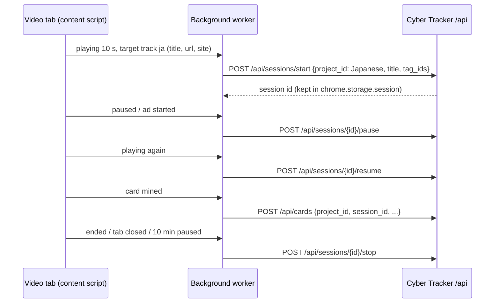
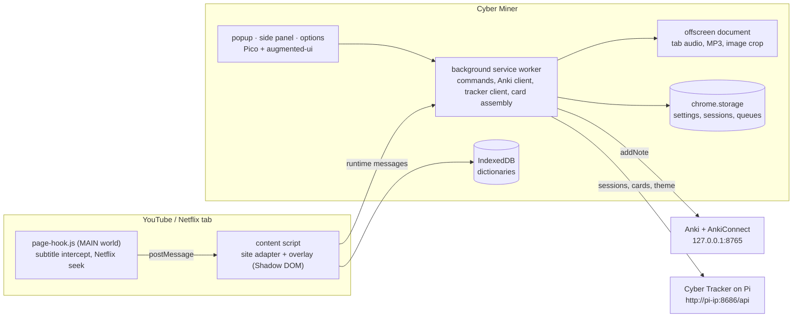
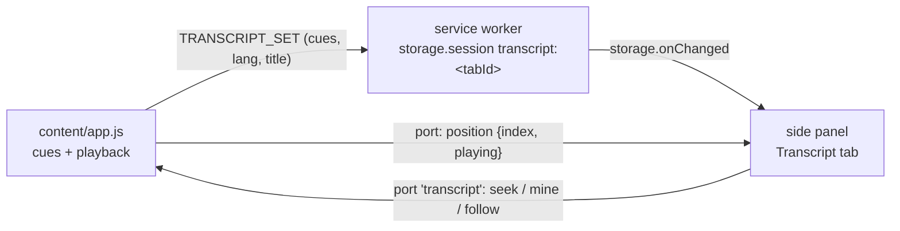
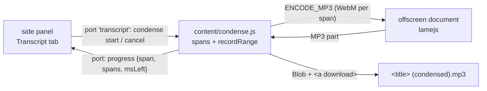

# ⌬ Cyber Miner — Design Doc

Oct 16, 2026

## Overview

Cyber Miner is a Chrome extension that turns subtitles on **YouTube** and **Netflix** into Anki sentence cards in one key press, styled like Cyber Tracker. It reads the subtitle line on screen, records the line's audio as MP3, grabs the video frame, lets you click a word to look it up, and sends the card to Anki through AnkiConnect. It also tells Cyber Tracker on the Pi how long you watched and how many cards you mined, so immersion and mining show up in the same statistics.

It lives in `extension/` in this repo and shares the tracker's theme presets, fonts and "no build step" rule (see [DESIGN.md](DESIGN.md) and [DECISIONS.md](DECISIONS.md)).

**Goals**

- Mine a sentence card in one key press, or two clicks when you want to pick a word first.
- Card has: sentence, English translation line, target word with reading (and pitch accent for Japanese) and definition, MP3 clip of the line, screenshot.
- Languages to mine: **Japanese**, **Chinese (Mandarin, simplified)** and **Italian**, with English as the translation track.
- Watch time is logged to Cyber Tracker automatically, into the project for the subtitle language, with no timer to remember.
- Cards mined show in Cyber Tracker's statistics as a "Cards mined" stat card.
- One MP3 of a whole video with the long pauses cut out ("condensed audio", M7), to listen to again and again away from the screen.
- Same look as Cyber Tracker: the five themes, augmented-ui shapes, Rajdhani and Share Tech Mono, everything vendored.

**Non-goals for v1**

- No Chrome Web Store release; loaded unpacked from the repo (Developer mode).
- No machine translation or AI APIs; the translation is a second subtitle track when the video has one.
- No image-based subtitles (some Netflix titles); no OCR. The panel says "image subtitles not supported" and offers loading a subtitle file.
- No sites beyond YouTube and Netflix; the site adapter design leaves room for more.
- No Firefox build. No listening or production card types.

**Prior art**

| Tool | What it does | Why we still build ours |
| --- | --- | --- |
| asbplayer | Open source; subtitle overlay, Netflix/YouTube, audio + screenshot to Anki | No tracker link, own look; good reference for Netflix subtitle and seek handling (check its license before copying code) |
| Yomitan | Dictionary popup on any page text | Not used by you; our built-in lookup replaces it. Overlay text stays real text, so it would still work |
| Language Reactor | Dual subtitles, word lookup | Closed source, paid features, no tracker |

## Decisions from the planning questions

| Topic | Decision |
| --- | --- |
| Machines | Chrome on Linux and Windows. Each machine runs its own Anki desktop with AnkiConnect; AnkiWeb sync joins them. Both talk to the same tracker on the Pi |
| Review | Anki desktop |
| Languages | Mine Japanese, Chinese (simplified, traditional shown in brackets) and Italian; English translation track |
| Lookup | Built-in lookup only (no Yomitan) |
| Japanese reading | Furigana on the target word only (Anki `{{furigana:}}`); pitch accent from an imported dataset |
| Note type | Own "Cyber Sentence" note type, one recognition card per note |
| Audio | Cue time ± padding (250 ms before, 500 ms after), MP3 |
| Decks | One per language: `Mining::Japanese`, `Mining::Chinese`, `Mining::Italian` (names changeable in options) |
| Duplicates | Warn with "already in deck" + Open in Anki; allow sending anyway |
| Anki tags | `cyber-miner`, site (`youtube` / `netflix`), show or channel (`show::Frieren`), date (`mined::2026-10-16`) |
| Translation on overlay | Blurred until hover (or Alt+S cycles: blurred, shown, hidden) |
| Mining vs. watch session | Mining only counts cards (linked to the session by id); the session keeps its own tags |
| Project mapping | By subtitle language: ja → Japanese, zh → Chinese, it → Italian. Options page creates missing projects |
| What counts as watch time | Only videos where a target-language subtitle track is loaded (overlay active) |
| Session title | Video title ("Frieren S1E3" or the YouTube title) |
| Tracker stats | "Cards mined" stat card (total and today) |
| Code | Plain JavaScript ES modules with JSDoc types, no build step |
| UI | Pico + augmented-ui + plain JS with a small form-binding helper for popup, options, side panel; plain DOM for the overlay (Alpine's CSP build was dropped in M1, see DECISIONS) |
| Tests | `node --test` for pure logic; hand checklist for sites |
| Install | Load unpacked from the repo; update with `git pull` + reload |
| Priority | YouTube first; first daily-use version is sentence + audio + picture, word typed by hand; dictionaries later |
| Hotkeys | Alt+M, Alt+Shift+M, Alt+R, Alt+S; A/D for previous/next line |
| Watch tags | `Watching` + `YouTube`, `Watching` + `Netflix` |
| Italian dictionary | Italian → English only (English Wiktionary extract) |
| Card front | Sentence + audio; everything else on the back |

## Tech stack

| Layer | Choice | Why |
| --- | --- | --- |
| Platform | Chrome Manifest V3, Chrome 116+ | Needed for offscreen documents, `tabCapture.getMediaStreamId` from the worker, side panel |
| Language | JavaScript ES modules, JSDoc type comments, `// @ts-check` | No build, same as the tracker; VS Code still checks types |
| Popup / options / side panel | Pico 2.0.6, augmented-ui 2.0.0, `styles/tracker.css` (copy of the tracker's `app.css`), plain JS + `shared/bind.js` (`data-field="anki.url"` two-way binding) | Same look as the tracker. MV3 forbids `eval`, and Alpine's CSP build only allows plain property paths (no arguments, `x-model` only with getter/setter objects), which made the options form all boilerplate |
| Overlay on video pages | Plain DOM in a Shadow DOM root, `styles/tracker.css` tokens + `styles/overlay.css` + augmented-ui | Content script stays small; page CSS cannot leak in. Pico is not used there (it styles `html`/`body`) |
| Fonts | Rajdhani, Share Tech Mono (copied from `app/static/vendor/fonts`) | Same look; loaded by `chrome.runtime.getURL` so YouTube/Netflix CSP does not block them |
| Themes | `shared/themes.json`, `styles/tracker.css` and `vendor/` copied from the tracker by `scripts/sync-extension.py`; live theme from tracker `GET /api/theme` | `app/` stays the one source for the look |
| Storage | `chrome.storage.sync` (settings), `chrome.storage.session` (tab → session map), `chrome.storage.local` (offline watch log, pending cards), IndexedDB (dictionaries) | Sync settings across your two machines; worker restarts lose nothing |
| Audio | YouTube: `video.captureStream()` + `MediaRecorder` in the page; Netflix (M4): `chrome.tabCapture`. Offscreen document decodes and encodes MP3 with lamejs 1.2.1 | No permission prompt on YouTube; MP3 plays everywhere. lamejs is LGPL-3.0: vendored unmodified with its license file |
| Images | YouTube: video frame drawn on a canvas, JPEG; Netflix (M4): `chrome.tabs.captureVisibleTab` + crop | Full resolution, no overlay flicker; DRM video needs the tab capture |
| Dictionaries | JMdict (jmdict-simplified JSON), Kanjium pitch accents, CC-CEDICT, Italian entries of English Wiktionary from kaikki.org; downloaded and compacted by `scripts/fetch-dicts.py` (see "Dictionary sources and download") | Free, offline; small compact files imported once into IndexedDB |
| Anki | AnkiConnect (add-on 2055492159), API version 6, `http://127.0.0.1:8765` | Standard; `requestPermission` avoids config edits |
| Tracker | Existing FastAPI JSON API + new `/api/cards`, `/api/theme` | Small server change |
| Tests | Node 22 `node --test` (dev only, no npm packages); pytest for tracker changes | Parsers and lookups are the risky logic |
| Lint (optional) | `npx tsc --noEmit --allowJs --checkJs` on demand | Type checks without a build |

## Core concepts

**Cue**: one subtitle line: `start_ms`, `end_ms`, `text`, `lang`, `role` (`primary` or `translation`). Every site adapter turns its subtitles into cues; everything after that is site-independent.

**Primary language**: the subtitle language that is one of ja, zh, it. It decides the deck, the dictionary, the tracker project and whether watch time counts. YouTube: the extension switches the player to the target-language track when one exists (manual track first, auto-generated second) and hides the native captions, because our overlay shows them. Netflix: same with Netflix's track list.

**Card draft** (fields of the "Cyber Sentence" note type):

| Field | Source | Notes |
| --- | --- | --- |
| Sentence | Primary cue at the current time (previous cue if between lines) | Target word wrapped in `<b>` |
| SentenceTranslation | English cue overlapping the primary cue | Empty if no English track |
| Word | Clicked word, or typed by hand (before M5) | |
| WordReading | Japanese: `食[た]べる` furigana syntax; Chinese: pinyin with tone marks; Italian: empty | Rendered with `{{furigana:WordReading}}` |
| WordPitch | Japanese pitch pattern from Kanjium, e.g. `[2]` drawn as an SVG line on the card | Japanese only |
| WordDefinition | First 3 senses from the dictionary | HTML list |
| Audio | `[sound:cyber_<id>.mp3]` | |
| Picture | `.jpg">` | Empty when the frame is black (DRM) |
| Source | "Frieren S1E3 · 12:41" | |
| SourceUrl | YouTube `watch?v=…&t=761s`; Netflix `watch/<id>?t=761` | |
| Lang | `ja`, `zh` or `it` | Card CSS uses it for font and layout |
| Notes | Free text from the side bar | |

`<id>` is a timestamp plus random suffix, so file names never collide across machines.

**Card template**: front shows the sentence (target word highlighted in the accent color) and the audio; back adds translation, picture, word with furigana or pinyin, pitch, definition, source link and notes. CSS comes from the theme chosen in options; "Push theme to Anki" re-sends it with `updateModelStyling`. Japanese and Chinese use the system CJK font (Rajdhani has no CJK glyphs), with Rajdhani for Latin text.

**Watch session**: one Cyber Tracker session per video, owned by the extension. Starts after 10 s of real playback with a target-language track loaded; pauses on pause and during YouTube ads; stops when the video ends, the tab closes or navigates, or after 10 min paused. Tags: `Watching` + `YouTube` for YouTube, `Watching` + `Netflix` for Netflix (names configurable; created in the project if missing, so tag stats split by site).

## Features and UI

**Overlay on the video page**

Nothing but the subtitle bar sits on the video; the card is made in the side bar next to it, so the picture and the subtitles stay visible.

1. Subtitle bar at the bottom of the player: primary line, English line under it, blurred until hover. Mounted inside the player element, so it stays in fullscreen. Press and hold it (0.4 s) to move it anywhere in the player, e.g. off burned-in subtitles; the spot is kept for every video (as % of the player, so it also fits fullscreen) until ⟲ on the bar or "Reset subtitle position" in the popup.
2. Click a character in the line: pause and mine the line with the word starting there selected and looked up in the side bar. Drag across characters: mine with exactly that text selected.
3. ⌬ button on the bar and Alt+M: pause and mine the line (no word selected yet). In fullscreen, mining first leaves fullscreen, because Chrome hides the side panel there.
4. Toast: "CARD MINED · 14 today" with "Open in Anki".
5. Status chip: Anki connected or not, tracker session running (●), language detected.

**Card side bar** (Chrome side panel, opened by mining, or from the popup)

1. Screenshot, audio player, Re-record.
2. The sentence in large type. Click a character: the longest dictionary word from there is selected (食べられなかった). Drag: exactly what you drag. "✎ Edit" changes the sentence text (fix auto-generated lines).
3. Dictionary results for the selection: term, reading, pitch, senses, how the form was traced ("potential or passive · negative · past", "form of parlare"). **Use** fills Word (dictionary form 食べる), Reading (食[た]べる / pinyin), Definition (first 3 senses, one per line, editable) and the pitch. The card bolds the text as it appears in the sentence.
4. Translation, Notes, deck, duplicate warning with "Send anyway", **Send to Anki** (Ctrl+Enter), Discard.
5. It follows the active tab: each tab keeps its own draft.

**Hotkeys** (Chrome `commands`, changeable at `chrome://extensions/shortcuts`)

| Action | Default |
| --- | --- |
| Mine current line (opens the card side bar) | Alt+M |
| Quick mine (send without the side bar) | Alt+Shift+M |
| Replay current line | Alt+R |
| Translation: blurred / shown / hidden | Alt+S |
| Previous / next line (seek) | A / D, while the overlay is active and focus is not in a text field |

**Transcript** (M5, in the side bar under the card): all lines of the video, current line highlighted, click to seek, ⌬ on a line to mine it.

**Popup**: Anki status and today's deck, tracker status, running watch session with a live clock (Share Tech Mono, like the tracker's timer cards), cards mined today, "Don't track this tab" switch.

**Options page**

- Anki: AnkiConnect URL, "Connect" (runs `requestPermission`), deck per language, create/check note type, "Push theme to Anki", send test note.
- Cards: audio padding (250 / 500 ms), MP3 bitrate (default 96 kbps mono), screenshot width (720 px) and JPEG quality (0.8), quick-mine on/off.
- Languages: target languages (ja, zh, it), translation language (en), Chinese display (simplified + traditional in brackets).
- Dictionaries: one row per language with the built file (from `extension/dicts/manifest.json`) and what is imported (version, rows, date); Import / Re-import with progress, Remove; credits line.
- Cyber Tracker: URL (e.g. `http://192.168.0.50:8686`), test button, language → project mapping with "Create missing projects", watch tags per site, switches for "log watch time" and "count mined cards".
- Theme: "Follow tracker" (default) or one of the five presets.

## How the hard parts work

**Subtitles**

| Site | Primary method | Fallback |
| --- | --- | --- |
| YouTube | A script in the page's own JS world (`world: "MAIN"`) wraps `fetch`/`XMLHttpRequest` and copies the player's own `/api/timedtext` responses (json3). Fetching `captionTracks` URLs directly is avoided: YouTube often requires a proof-of-origin token and returns empty results. The second (English) track is requested by switching the player's caption track briefly, or by YouTube's auto-translate (`tlang=en`) on the captured URL | Live `.ytp-caption-segment` text (no timings: no replay, no transcript) |
| Netflix | Same page-world hook catches the player manifest (`timedtexttracks`) and downloads the TTML/WebVTT files for the target and English tracks | Load a `.srt`/`.vtt`/`.ass` file by hand from the side bar |

The page-world script passes cues to the content script with `window.postMessage` (checked for a per-tab random token). Parsers are pure functions in `shared/subtitles.js`, tested on saved sample files.

**Seeking**: YouTube sets `video.currentTime`. Netflix fails with error M7375 when `currentTime` is set, so the page-world script calls Netflix's internal player API (`netflix.appContext.state.playerApp.getAPI().videoPlayer`, `seek(ms)`). This is the most fragile point; it sits behind the adapter's `seek()`.

**Audio clip (MP3)**

1. YouTube: the content script records the `<video>` element's own audio (`video.captureStream()` + `MediaRecorder`, WebM/Opus); no permission and no hotkey needed. Netflix (M4, DRM): `chrome.tabCapture` through the worker and the offscreen document, routed back to the speakers.
2. The video seeks to `cue.start − 250 ms` and plays at 1×; recording stops at `cue.end + 500 ms`; the old position is restored and the video stays paused.
3. The offscreen document decodes the clip and lamejs encodes it to MP3 (mono, 96 kbps, 44.1 kHz). A 4 s line is about 50 KB.

Recording replays the line in real time, so mining a 4 s line takes about 4 s. A rolling buffer that keeps the last 30 s of audio would be instant but drifts when you seek; replay is simpler and exact, so v1 uses replay.

Note: the Netflix part of step 1 changed during M4. The code asks for Chrome's "Share this tab" prompt (`getDisplayMedia`, `content/tabaudio.js`) once per page instead of `tabCapture`; see DECISIONS, M4c.

**Condensed audio (MP3)** (M7)

One MP3 of the whole video with only the spoken parts, for listening practice. The subtitles say where speech is, so the extension plays only the lines and seeks over the gaps.

1. **Spans**: each primary cue is padded (`−250 ms` / `+400 ms`). Neighbours whose gap is shorter than 1.5 s are merged, so short breaths stay and long silences go. A cluster longer than 60 s is split at a cue boundary. Result: a list of `{startMs, endMs}` spans.
2. **Record span by span** with the same `recordRange` as cards: seek to the span start, play at 1×, stop at the span end. YouTube records the element's audio; Netflix the shared tab audio. The gaps between spans are never recorded, because the recorder only runs inside a span.
3. **Encode** each span with the existing `encode-mp3` message (offscreen document + lamejs), mono 64 kbps, 44.1 kHz.
4. **Join**: lamejs writes bare MP3 frames (no ID3 or Xing header), and every part has the same rate, channels and bitrate, so the parts are simply concatenated into one valid file.
5. **Save**: the content script makes a `Blob` and downloads it through an `<a download>` link as `<title> (condensed).mp3`. No `downloads` permission, nothing goes to the tracker or Anki.

Why span by span and not one long recording: each message stays small (a 60 s span is about 1 MB of base64), the offscreen document never decodes a 25 min WebM (about 260 MB of PCM), a failed span is redone on its own, and Cancel leaves nothing half written.

It stays real time. Faster playback does not help, because the recorded audio would be fast too, and neither site gives the extension the raw audio stream (YouTube streams are not reachable from our hooks; Netflix is DRM). So a 24 min episode with 14 min of speech takes about 14 min to record. Music and sound effects inside a line are kept; videos without subtitles cannot be condensed.

**Screenshot**: YouTube draws the current video frame on a canvas (JPEG, 720 px wide). Netflix (M4): the worker calls `chrome.tabs.captureVisibleTab` and crops to the video rectangle. On Windows, Netflix frames are often black (hardware DRM); an all-black frame leaves Picture empty and the side bar says so. On Linux Netflix frames usually work.

**Word lookup**: dictionaries are downloaded and compacted by a script (next section), then imported once from Options → Dictionaries into IndexedDB (stores `entries`, `keys` (word → entry ids), `forms` (Italian), `pitch`, `meta`). Lookups run in the side bar; the language modules only see a small store interface, so the Node tests run them on fixture data.

- Japanese: longest match from the clicked character (up to 16 characters). Each length is traced back through a deinflection table built from the godan/ichidan/来る/する endings (negative, past, te, polite, potential, passive, causative, volitional, imperative, conditional, たい, ている/てしまう/ておく…, i-adjective forms); a candidate only counts if the entry's part of speech fits the traced class, so 食べられなかった finds 食べられる and 食べる. Katakana is also tried as hiragana. Reading follows the matched spelling; furigana is aligned (お茶 → お 茶[ちゃ]); pitch from Kanjium by word + reading, drawn as a small SVG on the card.
- Chinese: longest match in CC-CEDICT (up to 10 characters), simplified and traditional keys; pinyin with tone marks; variant/surname-only entries sorted last.
- Italian: the clicked word (letters, plus a trailing apostrophe for elisions: `l'`, `di'`). Looked up as written, through inflected forms (*parlavamo* → *parlare*, *amici* → *amico*), and with attached pronouns stripped (*parlarlo* → *parlare*, *dimmelo* → *di'* → *dire*). Compound entries (*dimmelo*, *fammi*) also show their lemma's meaning.

**AnkiConnect**: all calls go from the worker to `http://127.0.0.1:8765` (version 6). First run calls `requestPermission`, which shows a dialog in Anki to allow the `chrome-extension://<id>` origin. Calls used: `version`, `requestPermission`, `deckNames`, `createDeck`, `modelNames`, `createModel`, `updateModelStyling`, `updateModelTemplates`, `canAddNotesWithErrorDetail` (duplicate check on Sentence within the deck), `addNote` with `audio`/`picture` as base64 `data`, `guiBrowse`. If Anki is closed, the draft is kept in `chrome.storage.local` and the popup shows "1 card waiting for Anki" with a retry.

The extension ID must stay the same so the permission in Anki keeps working: `manifest.json` carries a fixed `key`, so the unpacked extension has the same ID on the Linux and the Windows machine.

## Dictionary sources and download

All four sources are free, CC BY-SA 4.0 (Wiktionary text is also GFDL), and checked on Oct 16, 2026. They are **not committed** to the repo: they are big, they update weekly or daily, and share-alike data is better fetched fresh than redistributed. The card back shows a small credit line per dictionary, as the licenses ask.

| Language | Source | File to download | Size (download → unpacked) | License |
| --- | --- | --- | --- | --- |
| Japanese | [jmdict-simplified](https://github.com/scriptin/jmdict-simplified) (JMdict from [EDRDG](https://www.edrdg.org/wiki/index.php/JMdict-EDICT_Dictionary_Project) as JSON, new release every Monday) | `jmdict-eng-<version>.json.tgz` from the [latest release](https://github.com/scriptin/jmdict-simplified/releases/latest) (Oct 12, 2026: `jmdict-eng-3.6.2+20261012204142.json.tgz`) | 11.5 MB → ~115 MB | CC BY-SA 4.0 (EDRDG licence) |
| Japanese pitch | [Kanjium](https://github.com/mifunetoshiro/kanjium) `accents.txt`: tab-separated word, reading, pitch numbers (e.g. `１ ⇥ ひと ⇥ 0,2`) | [`data/source_files/raw/accents.txt`](https://raw.githubusercontent.com/mifunetoshiro/kanjium/master/data/source_files/raw/accents.txt) | 3.2 MB | CC BY-SA 4.0 |
| Chinese | [CC-CEDICT](https://www.mdbg.net/chinese/dictionary?page=cc-cedict) from MDBG (updated daily) | [`cedict_1_0_ts_utf-8_mdbg.txt.gz`](https://www.mdbg.net/chinese/export/cedict/cedict_1_0_ts_utf-8_mdbg.txt.gz) | 4 MB → ~10 MB | CC BY-SA 4.0 |
| Italian | [kaikki.org Italian](https://kaikki.org/dictionary/Italian/index.html): Italian words in English Wiktionary, extracted with [wiktextract](https://github.com/tatuylonen/wiktextract) | [`kaikki.org-dictionary-Italian.jsonl.gz`](https://kaikki.org/dictionary/Italian/kaikki.org-dictionary-Italian.jsonl.gz) | 76 MB → 735 MB | CC BY-SA 4.0 + GFDL |

**Italian fallback**: kaikki.org marks the per-language Italian file "DEPRECATED, will be removed in the near future". If it disappears, the script switches to the full English Wiktionary dump [`raw-wiktextract-data.jsonl.gz`](https://kaikki.org/dictionary/raw-wiktextract-data.jsonl.gz) (~3 GB, all languages) and keeps only lines with `"lang_code": "it"`. Same JSON format, just a much longer download. Do not confuse it with `downloads/it/it-extract.jsonl.gz` on the [raw data page](https://kaikki.org/dictionary/rawdata.html): that is the *Italian* Wiktionary (definitions in Italian), which we decided not to use.

**Why a build script and not a browser import of the raw files**: the raw files are too big for a browser tab to parse comfortably (Italian is 735 MB of JSON) and carry far more than a lookup popup needs (etymology, translations, categories). The script keeps only what the card uses and writes small gzipped files that the browser unpacks with the built-in `DecompressionStream`.

**Download step** (once per machine, and again whenever you want newer dictionaries):

```bash
python3 scripts/fetch-dicts.py                 # all languages
python3 scripts/fetch-dicts.py ja zh           # only some
python3 scripts/fetch-dicts.py --force it      # download again even if cached
```

Then in Chrome: reload the extension, open **Options → Dictionaries**, press **Import** for each language.

What `scripts/fetch-dicts.py` does (Python 3 standard library only, no pip packages):

1. Downloads each source into `extension/dicts/raw/` (skipped if already there unless `--force`). JMdict's file name changes every week, so the script asks the GitHub API for the latest release and picks the asset named `jmdict-eng-*.json.tgz` (not the `-common` or `-examples` variants).
2. Streams each file (never loads the 735 MB Italian file into memory) and writes one compact file per language:

| Output | Lines (one JSON object each) | Size (Oct 19, 2026) |
| --- | --- | --- |
| `extension/dicts/ja.jsonl.gz` | header; 218,898 entries (kanji and kana spellings, common flag, first 5 senses with part of speech and up to 4 glosses); 465,845 keys; 124,137 pitch rows | 13.6 MB |
| `extension/dicts/zh.jsonl.gz` | header; 125,297 entries (simplified, traditional, pinyin with tone marks, glosses); 198,472 keys | 6.1 MB |
| `extension/dicts/it.jsonl.gz` | header; 171,535 entries (word, part of speech, glosses, lemma of compounds); 159,769 keys; 891,745 inflected forms → lemma + description | 11.5 MB |

Building all three from cached downloads takes about 30 s.

3. Writes `extension/dicts/manifest.json`: source URL, source version or date, entry count, sha256 and license per file. The options page reads it to show what is available and whether IndexedDB holds an older version.
4. Prints a summary table (entries, size per language).

`extension/dicts/` is in `.gitignore`. The options page streams the files with `fetch(chrome.runtime.getURL("dicts/ja.jsonl.gz"))` through `DecompressionStream`, 5,000 rows per IndexedDB transaction, so no file picker is needed and the whole file is never in memory; the files sit inside the unpacked extension folder on each machine.

## Cyber Tracker integration

**Watch time** uses the existing JSON API:



- One session per tab. The tab → session map lives in `chrome.storage.session` and is checked against `GET /api/sessions/running` when the worker wakes up.
- Next episode or next playlist video: stop the old session, start a new one with the new title.
- Tracker unreachable (Pi off, away from home): start, pauses and end are logged locally and sent as one `POST /api/sessions` (past session) once the tracker answers. Cards are queued the same way. No timer is left running on the Pi.

**Tracker changes** (milestone 0):

| Change | Detail |
| --- | --- |
| Table `MinedCard` | id, project_id, session_id (nullable), created_at, site, source_title, word, anki_note_id |
| Migration | `migrations/versions/0002_mined_cards.py` |
| `POST /api/cards`, `GET /api/cards` | Create (from the extension); list by ?project_id, ?from, ?to |
| Export / import | Cards in JSON export and import; CSV export unchanged (sessions only) |
| `GET /api/stats` | Adds `cards: {total, today, range}` (range = the selected range) |
| Statistics page | "Cards mined" stat card: total, with today underneath |
| `GET /api/theme` | Active preset name, scheme, fonts, colors (the same values the server writes into `<html style>`) |
| `scripts/sync-extension.py` | Copies `app.css`, Pico, augmented-ui, fonts and `THEMES` into `extension/` |

**Network and security**: the tracker has no login and speaks plain HTTP on the LAN. The extension asks for the tracker address only as an optional host permission (`chrome.permissions.request` when you save the URL), not for all sites. Requests come from the worker, so the tracker needs no CORS changes. Same rule as the tracker: never expose port 8686 to the internet; use Tailscale away from home.

## Architecture



**Messages** between content script, worker and offscreen document are plain objects with a `type`, listed in `shared/messages.js` (e.g. `cues`, `playback`, `mine`, `capture-audio`, `audio-ready`, `card-saved`) so every sender and receiver uses the same names.

**Site adapter interface** (one file per site):

```js
/** @typedef {{start_ms: number, end_ms: number, text: string, lang: string, role: "primary" | "translation"}} Cue */
export default {
  matches: (url) => boolean,
  getVideo: () => HTMLVideoElement,
  getPlayerElement: () => HTMLElement,   // overlay mount point, works in fullscreen
  getTitle: () => string,                // "Show S1E3" or video title
  getShow: () => string,                 // show or channel, for the Anki tag
  getSourceUrl: (timeMs) => string,
  isAd: () => boolean,
  seek: (ms) => Promise<void>,
  listTracks: () => Promise<{lang: string, kind: "manual" | "auto"}[]>,
  selectTracks: (primary, translation) => Promise<void>,
  onCues: (callback) => void,            // called with Cue[]
};
```

## Codebase outline

```text
extension/
├── manifest.json              # MV3, fixed "key"; permissions: storage, tabCapture, offscreen, sidePanel, activeTab, scripting, unlimitedStorage
├── background/
│   ├── service-worker.js      # message router, commands, card assembly
│   ├── anki.js                # AnkiConnect client, note type create/update, pending queue
│   ├── tracker.js             # Cyber Tracker client, watch sessions, offline log, card queue
│   └── capture.js             # tab stream id, screenshot, black-frame check
├── content/
│   ├── main.js                # picks adapter, mounts overlay, playback events
│   ├── overlay.js             # subtitle bar (clickable characters), status chip, toast (Shadow DOM)
│   ├── page-hook.js           # MAIN world, shared: fetch/XHR copy of the URLs the site file wants, command plumbing
│   ├── hooks/                 # MAIN world, per site: which responses to copy, player commands (Netflix seek)
│   │   ├── youtube.js
│   │   └── netflix.js
│   └── sites/
│       ├── index.js           # adapter interface, picks the adapter by hostname
│       ├── youtube.js
│       └── netflix.js
├── offscreen/
│   ├── offscreen.html
│   ├── offscreen.js           # getUserMedia(tab), route to speakers, record, MP3, crop
│   └── pcm-worklet.js         # AudioWorklet collecting PCM frames
├── popup/                     # popup.html, popup.js
├── sidepanel/                 # card editor: sentence picking, dictionary results, fields, send (transcript in M5)
├── options/                   # options.html, options.js
├── shared/
│   ├── messages.js            # message type names
│   ├── settings.js            # defaults + chrome.storage.sync wrapper
│   ├── subtitles.js           # json3, TTML, WebVTT, SRT, ASS parsers + cue lookup
│   ├── card.js                # draft → Anki fields + tags; note type templates + CSS
│   ├── wordpick.js            # word around a click without a dictionary; line -> sentence offsets
│   ├── dictionary/
│   │   ├── index.js           # lookupAt(lang, sentence, offset, end?) for the side bar
│   │   ├── db.js              # IndexedDB stores, streamed import with progress, DictStore
│   │   ├── memory-store.js    # DictStore from JSON lines (tests)
│   │   ├── ja.js              # longest match, deinflection, furigana, pitch
│   │   ├── zh.js              # longest match, simplified/traditional
│   │   └── it.js              # word span, inflected forms, clitic stripping
│   ├── bind.js                # data-field two-way form binding
│   ├── brand.js               # ⌬ inline SVG
│   ├── themes.json            # copied from app/config.py (scripts/sync-extension.py)
│   └── theme.js               # apply tokens to :root or a shadow root
├── styles/
│   ├── tracker.css            # copy of app/static/app.css (scripts/sync-extension.py), never edited here
│   └── extension.css          # popup/options additions
├── vendor/                    # pico.min.css, augmented-ui.min.css, fonts/ (synced from app/static/vendor), lame.min.js (M2) (+ license files)
├── package.json               # only "type": "module" for node --test; no dependencies
├── icons/                     # ⌬ 16/32/48/128 PNG
├── dicts/                     # git-ignored: raw/ downloads + compact *.json.gz + manifest.json (scripts/fetch-dicts.py)
└── tests/
    ├── fixtures/              # saved json3, TTML, VTT, SRT, ASS files; small dictionary samples
    ├── subtitles.test.js
    ├── card.test.js
    └── dictionary.test.js
```

Run tests with `cd extension && node --test 'tests/*.test.js'`. Tracker changes get pytest tests like the rest of the app.

## Build plan

Each milestone ends with something you can use or see. Tasks are in build order.

**M0 · Tracker API** (server, this repo's Python side)

1. `MinedCard` model + migration `0002`.
2. `POST /api/cards`, `GET /api/cards`; schemas; 400/404 like the rest of the API.
3. Cards in JSON export/import (old exports without cards still import).
4. `cards_total`, `cards_today`, `cards_range` in stats service and `/api/stats`; "Cards mined" stat card.
5. `GET /api/theme`; `scripts/sync-extension.py`.
6. pytest: card create/list, stats counts, export round trip, theme endpoint.

Done when: pytest green; a card posted with curl shows on the Statistics page.

**M1 · Skeleton, theme and Anki**

1. `manifest.json` with fixed key, icons, empty worker, popup, options.
2. `scripts/sync-extension.py` (Pico, augmented-ui, fonts, `tracker.css`, `themes.json`); `theme.js` (follow tracker or preset); `bind.js`.
3. `settings.js` with defaults in `chrome.storage.sync`.
4. `anki.js`: connect + `requestPermission`, create decks per language, create "Cyber Sentence" note type (fields, template, CSS from theme), push theme, send test note.
5. Options page: Anki section, languages, theme. Popup: Anki status.
6. Tests: `card.js` field and tag building.

Done when: "Send test note" creates a styled Cyber Sentence card in `Mining::Japanese`.

**M2 · YouTube mining — first daily-use version**

1. `page-hook.js` timedtext intercept; `subtitles.js` json3 parser + cue-at-time; fixtures and tests.
2. `youtube.js` adapter: video, player, title, channel, ads, seek, track list and selection (target + English).
3. Overlay: subtitle bar with blurred translation, status chip, Alt+S, A/D, Alt+R.
4. Screenshot: hide overlay, capture, crop, black check.
5. Offscreen audio: stream id, route to speakers, PCM worklet, replay window, MP3 encode.
6. Card panel: sentence, select text → "Set as word", translation, preview, audio, deck, notes, duplicate warning, send; quick mine (Alt+Shift+M); toast. *Replaced in M2b by the side bar.*
7. Pending-card queue when Anki is closed.

**M2b · Card side bar and word lookup** (after testing M2: the in-player panel covered the subtitles; M5's dictionaries moved forward)

1. Card editor in Chrome's side panel; one draft per tab in `storage.session`, shown live as the audio finishes; opened by Alt+M, the ⌬ button or a click on a subtitle character; leaves fullscreen first.
2. Subtitle bar: one span per character, click = mine with the word from there, drag = exact selection. In-player panel removed.
3. Card bolds the selected range as it appears in the sentence; Word holds the dictionary form.
4. `scripts/fetch-dicts.py`, IndexedDB import (Options → Dictionaries), lookups for Japanese (deinflection, furigana, pitch), Chinese and Italian (forms, clitics); pitch SVG on the card.
5. Tests: dictionary lookups on fixture excerpts, pitch graph, fetch-dicts on tiny inputs (pytest).

Done when: Alt+M opens the side bar beside the video; clicking 食べられなかった selects it and offers 食べる with 食[た]べる and pitch [2]; 学习 shows xué xí; *dimmelo* finds *dire*.

Done when: you mine a real card from a Japanese, a Chinese and an Italian YouTube video, with MP3 and picture, on both Linux and Windows.

**M3 · Watch time and card counts** (done 2026-10-22; see DECISIONS)

1. Playback events (10 s threshold, pause, ads, end, navigation, tab close, 10 min idle).
2. `tracker.js`: options URL + optional permission, test button, language → project mapping, "Create missing projects", watch tags.
3. Start/pause/resume/stop; `storage.session` map; reconcile with `/api/sessions/running`.
4. Offline log → past session; card queue → `POST /api/cards`.
5. Popup: live session clock, cards today, "Don't track this tab".

Done when: an hour of Japanese YouTube shows as one session under Japanese with Watching + YouTube tags, and cards mined appear in "Cards mined".

**M3b · Known words from Anki** (done 2026-10-22, built after M4 was planned; see DECISIONS): words in the bar coloured by their Anki status from chosen decks and fields, side panel badge with an "Already mined" warning, colours set per status in Options.

**M4 · Netflix** (done 2026-10-22; see DECISIONS)

Decided 2026-10-21 (audio and picture changed during the build, see DECISIONS: Chrome's "Share this tab" prompt once per tab, and tab screenshots with the optional all-sites permission); Japanese ruby is dropped from the Sentence (our furigana stays on the target word); Linux and Windows both supported (black frames on Windows leave Picture empty); loading a subtitle file by hand moves to M6.

1. M4a, adapter refactor with no change on YouTube (built; see DECISIONS): `content/sites/index.js` defines the adapter and picks it by hostname; YouTube subtitle loading moved from `app.js` into `youtube.js` behind `subtitles(video, target, {…callbacks})`; `seek()` (awaited by the recorder), `controlsHidden()`, `onNavigate()` on the adapter; `page-hook.js` keeps the shared plumbing and fetch/XHR copy, player commands moved to `content/hooks/youtube.js`. Test YouTube, commit.
2. M4b, subtitles (built; see DECISIONS): hook copies the player manifest (`timedtexttracks`) and `/metadata`; `netflix.js` downloads target + English tracks (`imsc1.1`, `dfxp-ls-sdh` or `webvtt-lssdh-ios8`); `parseTtml` (tick timebase, `<br>`, ruby removed) and `parseVtt` with node fixtures; native `.player-timedtext` hidden.
3. M4c, mining: seek through Netflix's player API (setting `currentTime` gives M7375); adapter gets `audio: "element" | "tab"` and `frame: "canvas" | "tab"`; `tabCapture` stream kept in the offscreen document and routed back to the speakers, recorder "tab" mode; `captureVisibleTab` + crop, black-frame check; title "Show S1E3"; manifest adds netflix.com and `tabCapture`.
4. M4d: next episode (new `/watch/<id>`) starts a new session; image subtitles (`nflx-cmisc` only) show a message; hand checklist on Linux and Windows.

Done when: card + watch session from a Netflix episode, and autoplay to the next episode starts a new session.

**M5 · Transcript** (planned and built 2026-10-22, M5a–c; see DECISIONS; dictionaries moved to M2b)

Every subtitle line of the video in the side panel, following the video, so you can read ahead or back, jump to a line and mine any line, with the known-word colours from M3b. Works the same on YouTube and Netflix: it only uses what the content script already has (`state.primary`, `state.translation`).

Side panel layout: two tabs at the top, **Card** and **Transcript**. With no card in progress the panel opens on Transcript; mining switches to Card, and Send or Discard goes back to Transcript.

Data flow:



- **Lines** go through the worker into `storage.session` (`transcript:<tabId>`: video id, title, lang, cues with start/end/text, translation text per line), like drafts, because content scripts cannot use `storage.session`. A few hundred lines are well under its 10 MB. Cleared on a new video and when the tab closes.
- **Position** goes over a direct port (`chrome.tabs.connect(tabId, {name: "transcript"})` from the panel), sent only when the current line index or play state changes, so nothing is written to storage every 100 ms.
- **Commands** from the panel over the same port: `seek {index}` (to the line's start, keeps playing or paused as it was), `mine {index}` (seek there, pause, mine that line: same flow as ⌬, panel switches to Card).

Steps:

1. **M5a, content and worker**
   - `shared/transcript.js` (new, pure, tested): `transcriptRows(primary, translation, lang)` → `[{i, start_ms, end_ms, text, sentence, translation}]` (translation per line with `overlappingText`), and `lineAt(rows, ms)` (reuses `cueIndexAt`).
   - `content/app.js`: after `onPrimary`/`onTranslation`, send `TRANSCRIPT_SET`. `setupVideo` sends `TRANSCRIPT_CLEAR`. `chrome.runtime.onConnect` for the `transcript` port. `tick` posts the line index when it changes. `mine()` gets an optional `cueIndex` (today it always takes the line at the playhead).
   - `background/service-worker.js`: `TRANSCRIPT_SET` / `TRANSCRIPT_CLEAR` handlers write/remove `transcript:<tabId>`; tab close removes it too (next to the draft).
   - `shared/messages.js`: the two message names and the port name.
2. **M5b, the Transcript tab**
   - `sidepanel/sidepanel.html`: tab bar (Card | Transcript) and a `#transcript` section: a header with the title and line count, a list, and a "Follow video" toggle.
   - `sidepanel/transcript.js` (new module, the panel's main file only switches tabs):
     - Rows: time (`12:41`), the line in the target language, the translation under it (blurred, shown or hidden by the same Options setting as the bar), and ⌬ on hover.
     - The current line is highlighted, and the list scrolls to keep it in view while "Follow" is on. Scrolling by hand turns Follow off until you press it again.
     - Click a line to seek there; ⌬ to mine it.
     - The list is rendered once per video, and only the highlight moves on each position update.
   - `sidepanel/sidepanel.css`: tabs, rows, highlight in the tracker style (accent border on the current line).
   - Netflix: mining from the panel needs the tab audio to be shared already (Chrome only shows "Share this tab" after a click in the page). If it is not, the Card tab says "click ⌬ on the video once to share this tab's audio".
3. **M5c, known words in the transcript**
   - Each row's words are coloured like the bar (same `markWords`, same colour settings), done in the panel itself (it has the dictionaries and `knownWords`), only for rows near the visible area (IntersectionObserver) and cached per line.
   - A small "3 new" count per row (words not in Anki), and a filter toggle **"Lines with new words"** to show only those, to find good lines to mine quickly.
4. **M5d, tests and docs**
   - `tests/transcript.test.js` for `transcriptRows` / `lineAt` with the json3 and Netflix fixtures.
   - DECISIONS section, READMEs (EN/JA) feature text and a screenshot `readme-11.png` of the Transcript tab.

Done when: the transcript follows the video on YouTube and Netflix, clicking a line jumps there, ⌬ on a line opens the Card tab with that line, and new words are coloured and countable per line.

**M6 · Polish**

1. Re-record with other padding; adjust start/end in the panel.
2. Shift-click lines in the side bar transcript to merge several cues into one card.
3. Export/import extension settings; "Report a broken site" note in the Ideas list via `POST /api/ideas`.
4. README section for install, AnkiConnect setup, dictionary downloads.
5. Load a subtitle file by hand (SRT, VTT, ASS) from the side bar, for Netflix titles with image subtitles and for YouTube.

**M7 · Condensed audio** (planned 2026-10-26)

One MP3 of the whole video with long pauses cut, to listen to on repeat. Works the same on YouTube and Netflix: it uses the primary cues the content script already has (`state.primary`), the card recorder (`recordRange`) and the card MP3 encoder (`encode-mp3`). How it works: see "Condensed audio (MP3)" under How the hard parts work.

Decided 2026-10-26: gaps are found from the subtitles, not from loudness (recording time is the condensed length, not the whole video); output is the MP3 only (no LRC or SRT); the file is downloaded, not stored in the tracker or Anki.

Data flow:



Steps:

1. **M7a, spans**
   - `shared/condense.js` (new, pure, tested): `planSpans(cues, {padBeforeMs, padAfterMs, mergeGapMs, maxSpanMs})` → `[{startMs, endMs, firstCue, lastCue}]`, and `condensedMs(spans)` for the time estimate.
   - `tests/condense.test.js` with the json3 and Netflix fixtures: padding, merging under and over `mergeGapMs`, split at `maxSpanMs`, overlapping cues, the first cue near 0 (no negative start), the estimate.
2. **M7b, the runner**
   - `content/condense.js` (new): for each span, `recordRange(video, startMs, endMs, {seek: adapter.seek, audioTracks, isCancelled})`, then `ENCODE_MP3` with the condense bitrate; keeps the MP3 parts as bytes; at the end joins them into one `Blob` and downloads it. Restores the old position and play state when done or cancelled.
   - Checks per span: if the span played short (`toMs < endMs − 300`) or the time jumped, redo it once. YouTube ads: the adapter gets `adShowing()` (`#movie_player` has `ad-showing`; Netflix returns false); the runner waits until the ad is over and redoes the span. On the Netflix ad tier the jump check catches it.
   - While it runs, the bar's mining and hotkeys are off (`mine()` and replay say "Recording condensed audio"), and the watch session keeps counting as normal playback.
   - `content/app.js`: the `transcript` port gets `condense {}` and `condense-cancel {}`; progress goes back on the same port.
   - `shared/messages.js`: the port command names.
3. **M7c, side panel and options**
   - Transcript tab header: **Condensed audio** button. Before starting it shows "≈ 14 min to record · 23 min video · 380 lines". While running: a progress bar (span n of N, minutes left) and Cancel. Done: "Saved <file name>".
   - No subtitles loaded: button disabled with the reason. Netflix with the tab not shared yet: same message as mining from the panel (M5).
   - UI note while running: "Keep this tab playing with sound; muting or hiding it can make spans run long" (see Risks).
   - `shared/settings.js` defaults `condense: {mergeGapMs: 1500, padBeforeMs: 250, padAfterMs: 400, kbps: 64}`, and an Options section "Condensed audio" for the four values.
4. **M7d, tests and docs**
   - Hand checklist rows (below), DECISIONS section, READMEs (EN/JA) feature text.

Done when: a YouTube video (with a mid-roll ad) and a Netflix episode each give one MP3 that plays start to end in a normal player (VLC, phone), with no silence longer than about 1.5 s, no ad audio, and a length close to the estimate.

## Hand test checklist (each release)

- YouTube: manual ja subtitles; auto-generated only; no ja track (no tracking, overlay off); pre-roll and mid-roll ads; playlist next video; fullscreen; theater mode.
- Netflix: Japanese episode with English subs; next-episode autoplay; title with image subtitles; fullscreen; screenshot on Windows (empty picture, no black image).
- Anki closed when mining; tracker offline during a whole video; worker restarted mid-video (`chrome://serviceworker-internals`).
- Condensed audio (M7): whole YouTube video with a mid-roll ad; whole Netflix episode; Cancel halfway (no file, position restored); tab in the background during recording; the MP3 plays to the end in VLC and on a phone.

## Risks

| Risk | Effect | Plan |
| --- | --- | --- |
| YouTube or Netflix change their player or subtitle requests | Subtitles or seek stop working | Site code only in adapters + page hook; hand checklist; subtitle file fallback |
| Netflix DRM on Windows | No pictures from Netflix on Windows | Detect black frames, send card without picture |
| Capturing tab audio mutes the tab | No sound while recording | Route the stream back to the speakers |
| MV3 worker stops when idle | Lost session state | All state in `chrome.storage`; reconcile on wake |
| Dictionary size in IndexedDB | Slow first import, ~100–300 MB disk | Compact files from `fetch-dicts.py`, streamed import with progress, only languages you enable, `unlimitedStorage` |
| kaikki.org removes the per-language Italian file | Italian download fails | Script falls back to the full raw dump filtered on `lang_code` |
| Source formats change (jmdict-simplified major version, wiktextract fields) | Script or import breaks | Script checks the JMdict major version and required fields, fails with a clear message; sample-file tests |
| Italian inflection coverage | Some forms not found | form-of entries + clitic table; manual word entry always works |
| lamejs license (LGPL-3.0) | Must keep it replaceable and credited | Vendored unmodified with license; personal use, not distributed in a store |
| Site terms of service | Intercepting subtitles is a gray area | Personal use, no store release, no video downloading |
| Condensed audio: Chrome slows timers in hidden or muted tabs | The recorder checks the end time late, spans run long | Audible tabs are not slowed: keep the tab playing with sound, say so in the panel; the span end check uses `video.currentTime`, so a late check only adds a little audio |
| Condensed audio: seeking between spans buffers | Pauses while recording | Recorder runs only inside a span, so buffering is never recorded; only total time grows |
| Condensed audio: YouTube ad in the middle of a span | Ad audio in the file | Adapter `adShowing()`, wait and redo the span |
| Condensed audio: long video | Memory in the content script | Only MP3 parts are kept (about 0.5 MB per minute at 64 kbps) |
| Condensed audio: auto-generated YouTube subtitles with loose timing | Words cut at span edges | Padding plus `last_word_ms` end times; padding is a setting |

## Open questions

None left from planning. New questions found during the build go to [DECISIONS.md](DECISIONS.md) under a "Cyber Miner" section, the same way v1 of the tracker did.
