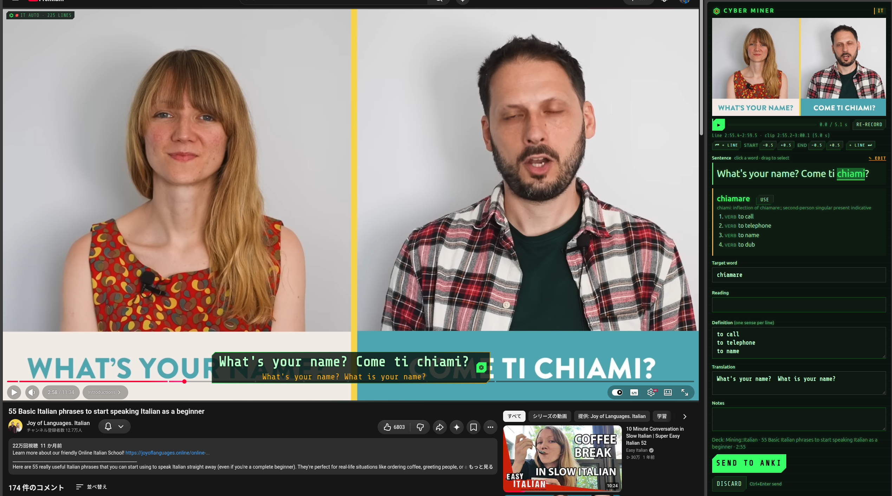
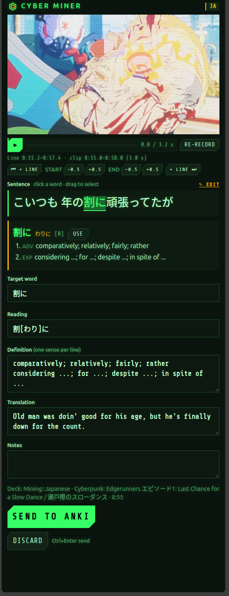
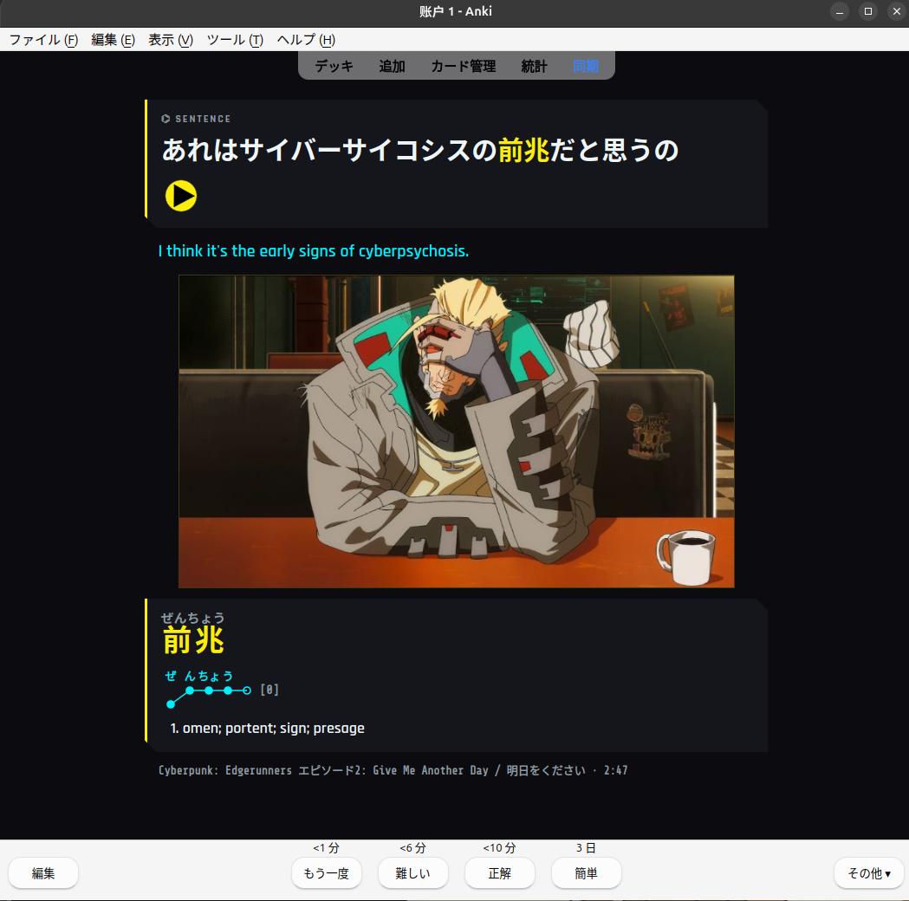
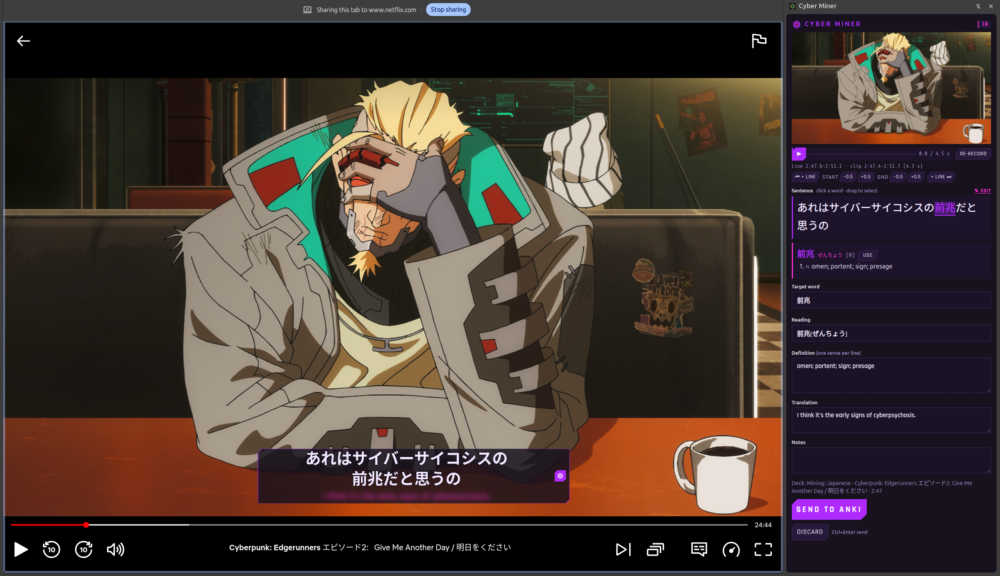
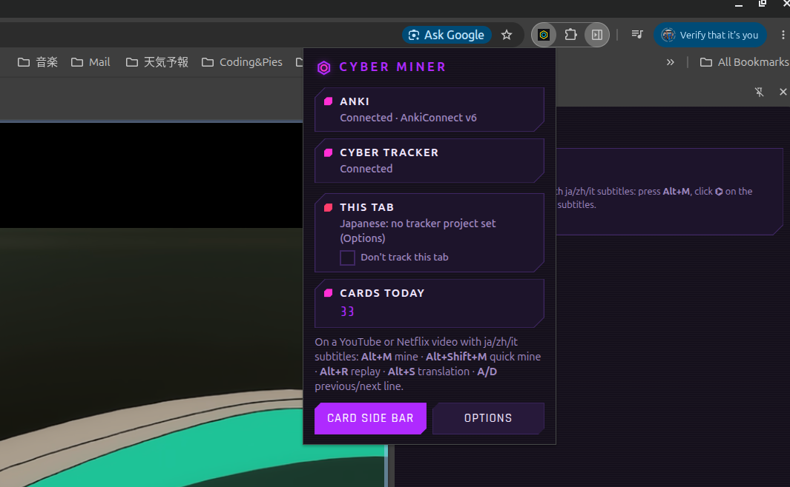
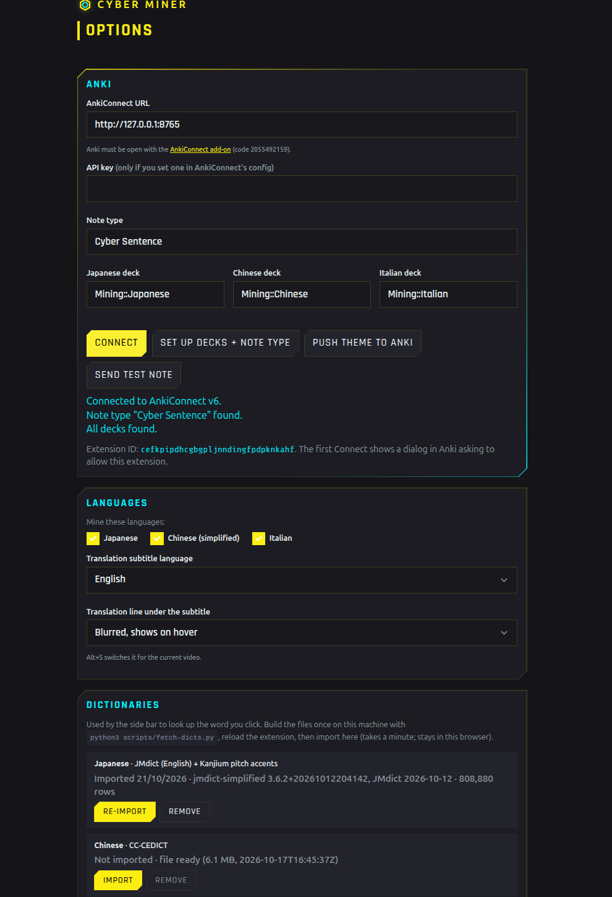

[English](README.md) | **日本語**

# ⌬ Cyber Miner

**YouTube** と **Netflix** の字幕から Anki の例文カードを作る Chrome 拡張機能です。デザインは Cyber Tracker と同じです。字幕の行を動画の上の独自のバーに表示します。単語をクリックすると動画が止まり、その行の音声を MP3 で録音し、フレームを撮って単語を辞書で引きます。カードは Chrome のサイドパネルで作り、AnkiConnect 経由で Anki に送ります。視聴時間と作ったカード数は [Cyber Tracker](../README.ja.md) に記録されるので、インプットとカード作りが同じ統計に並びます。

対応言語：**日本語**、**中国語（簡体字）**、**イタリア語**。翻訳の行は英語です。



素の JavaScript（ES モジュール）、Manifest V3、ビルド手順なし、npm の依存なし。「パッケージ化されていない拡張機能」として読み込みます。Chrome ウェブストアには公開していません。設計と開発計画：[docs/EXTENSION_DESIGN.md](../docs/EXTENSION_DESIGN.md)。開発中に決めたこと：[docs/DECISIONS.md](../docs/DECISIONS.md)（「Cyber Miner」の節）。docs は英語のみです。

## 機能

### 字幕バー
- サイト本来の字幕の代わりに、プレーヤーの中に 1 本のバーを表示します。学習中の言語の行と、その下に英語の行。
- **翻訳の行**：ホバーするまでぼかす（標準）、常に表示、非表示 の 3 つ。オプション > Languages で設定し、**Alt+S** で今の動画だけ切り替えられます。
- **文字をクリック**すると、そこから始まる単語（辞書で最も長く一致するもの）でその行のカードを作ります。文字を**ドラッグ**すると、選んだ部分そのものを使います。
- **⌬ ボタン**は単語を選ばずにその行のカードを作ります。
- **A / D** で前 / 次の行へ移動、**Alt+R** で今の行をもう一度再生します。
- **バーの移動**：バーを 0.4 秒長押しすると、動画内の好きな場所へドラッグできます。位置はすべての動画で共通で、パソコン間で同期されます。バーの **⟲**（ホバーで表示）か、ポップアップの「Reset subtitle position」で元の位置に戻ります。
- 大きさはウィンドウではなくプレーヤーに合わせるので、小さなプレーヤーでも、シアターモードや全画面でも収まります。プレーヤーの操作バーが隠れると下に下がります。


### カードを作る
カードを作り始めると動画が止まり、全画面が解除され、動画の横に**サイドパネル**が開きます。

<p align="center"></p>

- **画像**：動画のフレーム（YouTube：動画から直接描画、Netflix：操作バーを隠したタブのスクリーンショットを映像部分だけに切り抜き）。下に、その行の再生中に撮ったフレームのサムネイルが並び、クリックするとその画像を使います。
- **音声**：その行をリアルタイムで再生し直して録音し、MP3 にします。アプリのデザインのプレーヤーで聞けます（Space で再生/一時停止）。
- **区間の調整**：開始や終了を 0.5 秒ずつずらしたり、前 / 次の字幕行を加えたりできます（「⏮ + line」「+ line ⏭」）。変えるたびに録音し直します。再生が途中で止まったときは時間表示に警告が出ます。
- **文**：単語をクリックするか範囲をドラッグすると、それがカードの単語になります。✎ Edit で文を直せます。
- **辞書**（オフライン、ブラウザ内）：
  - 日本語：JMdict（読みとピッチアクセント：Kanjium）、活用形からの原形検索（食べなかった → 食べる）。
  - 中国語：CC-CEDICT（ピンイン付き）。
  - イタリア語：Wiktionary（kaikki.org）、活用形と接語に対応（dimmelo → dire）。
  - 「Use」で単語・読み・意味の欄が埋まります。どの欄も手で直せます。
- **Send to Anki**（Ctrl+Enter）。デッキに同じカードがあれば知らせ、「Send anyway」で送れます。Anki が閉じているときはカードを保存しておき、Anki が開いたら送ります。
- **クイック作成**（**Alt+Shift+M**）：サイドパネルを開かずに、その行をすぐ送ります。

### 字幕一覧
サイドパネルの **Transcript** タブに、動画のすべての字幕行と翻訳を表示します（翻訳はバーと同じく、ぼかす・表示・非表示）。
- **動画に追従**：今の行をハイライトし、見える位置に保ちます。手でスクロールすると止まり、**⇣ Follow video** で戻ります。
- **行をクリック**するとその場面へ移動、行の **⌬** でその行のカードを作り、Card タブを開きます。
- **複数の行を 1 枚のカードに**：別の行を Shift+クリックすると間の行がすべて選ばれ（最大 10 行）、**⌬ Mine as one card** で作ります。
- バーと同じ**単語の色分け**と、行ごとの「3 new」の数。**Lines with new words** で、Anki にない単語を含む行だけを表示し、カードにする行を探せます。
- カード作成中でなければパネルは Transcript で開き、新しいカードで Card に切り替わり、送るか破棄すると戻ります。
- Netflix では、パネルからカードを作るにはタブの音声がすでに共有されている必要があります（タブごとに一度、動画の ⌬ をクリック）。

<p align="center"></p>

### 間を詰めた音声（Condensed audio）
動画全体から長い無音を除いた MP3 を 1 つ作り、画面を見ずに何度でも聞けます。
- Transcript タブの上の **♫ Condensed audio** に、かかる時間が出ます（「≈ 14 min to record · 23 min video」）。
- **Start** で保存先を選びます。最初はダウンロードフォルダ、次からは前回選んだフォルダが開きます。
- 字幕の行だけを再生し、1.5 秒より長い間は飛ばします。実時間で録音するので、できる MP3 とほぼ同じ時間がかかります。録音中は進捗バーと **Cancel** が出ます。
- **録音中は動画を操作しないでください**：プレーヤーのシークバーで動かすと元に戻され、その部分を録り直します。行への移動やカード作成は先に確認があり、動画の上では ⌬・A/D・Alt+R を 2 回押すと録音を止めます。
- タブは音を出したまま再生してください（ミュートや非表示のタブは Chrome が遅くします）。Netflix では先に動画の ⌬ を一度クリックしてタブの音声を共有し、Netflix の音量は最大にしてください。
- 前後の余白、飛ばす間の長さ、ビットレートはオプションの「Condensed audio」で変えられます。

### Anki のカード
専用のノートタイプ **Cyber Sentence** と、言語ごとのデッキ（`Mining::Japanese`、`Mining::Chinese`、`Mining::Italian`）を使います。見た目は Cyber Tracker と同じテーマ色とフォントで、オプションから Anki に送ります。

フィールド：Sentence、SentenceTranslation、Word、WordReading、WordPitch、WordDefinition、Audio、Picture、Source（「Frieren S1E3 · 12:41」）、SourceUrl（その場面へのリンク）、Lang、Notes。日本語は単語にふりがなと、ピッチアクセントの図が付きます。タグ：`cyber-miner`、サイト名、`show::<作品名>`、`mined::<日付>`。



### 覚えた単語
Cyber Miner は Anki のデッキを読んで、字幕の各行の単語に色を付けます：
- **アクセント色**：デッキにない単語（これから覚える単語）。
- **点線の下線**：Anki にあるが、まだ覚えていない単語。
- **色なし**：覚えた単語（カードの間隔が 21 日以上、Anki の「成熟」。日数はオプションで変更可）。

助詞・冠詞・前置詞などの文法語には色を付けません。それぞれの状態の見た目は **オプション > Known words** で変えられます（色なし、テーマの色、下線）。新しいデッキでは、Anki にない単語を「No colour」にして、覚えた単語に色を付けるのもおすすめです。
- **サイドパネルのバッジ**：単語の欄の下に、選んだ単語の状態を表示します。「New word」「Learning · 5 d」「Known · 45 d」とデッキ名、またはすでにカードがあるときは警告として **「Already mined in Mining::Japanese」**。それでも送ることはできます。
- **対象のデッキ**：Cyber Miner のデッキは常に対象です。ほかの単語デッキは **オプション > Known words** で追加します（デッキ、単語の入ったフィールド、言語）。
- **更新**：Anki が開いている間は 1 時間ごと、または「Refresh from Anki」で読み直します。作ったカードの単語はすぐに反映されます。

### Netflix
YouTube と同じように使えます：
- **字幕**：Netflix はエピソードのすべての字幕トラックの一覧を持っています。拡張機能は学習中の言語のトラックと英語のトラックを直接ダウンロードします。日本語字幕のふりがなは文から外します。
- **言語の選び方**：Netflix は多くの言語の字幕があるので、**再生中の音声の言語**で字幕トラックを選びます。Netflix のメニューで音声を切り替えると、字幕も切り替わります。音声が日本語・中国語・イタリア語でない場合はメッセージを表示します。
- **シーク**は Netflix 自身のプレーヤーを使います（動画の時間を直接変えると Netflix が壊れるため）。
- **画像**には一度だけ **オプション > Cards >「Allow Netflix pictures」** が必要です（Chrome はすべてのサイトへのアクセス権がある場合だけタブのスクリーンショットを許可します。拡張機能が動くのは YouTube と Netflix だけです）。
- **音声**は Chrome の**「このタブを共有」**ダイアログを使います。Netflix のタブで最初に ⌬ か単語をクリックしたとき、「タブの音声も共有する」にチェックを入れたまま許可してください。タブを閉じるか再読み込みするまで共有が続きます。
- **Windows** では Netflix のスクリーンショットが黒くなることがよくあります（ハードウェア DRM）。その場合カードは画像なしで送られます。



### Cyber Tracker の視聴時間
- 日本語・中国語・イタリア語のトラックがある動画を 10 秒再生すると、Cyber Tracker に**視聴セッション**が始まります。その言語に選んだプロジェクトの下に、「Watching, YouTube」か「Watching, Netflix」のタグで記録されます。
- 動画の一時停止中と広告中はセッションも止まります。カード作りの時間は学習時間として数えます。カードを作るとセッションに **Mining** タグが付きます（タグ名はオプションで変更、空にすると付きません）。
- 動画が終わる、動画を離れる、10 分間一時停止のまま、のどれかで終了します。
- **作ったカード**は Cyber Tracker で数えられます（統計画面の「Cards mined」）。
- **トラッカーに繋がらないとき**は、セッションとカードを保存しておき、後で送ります。
- **ポップアップ**には、このタブのセッション（経過時間付き）、今日のカード数、「Don't track this tab」が表示されます。**Open Cyber Tracker** でトラッカーのタブに切り替えるか、開きます。

<p align="center"></p>

### ショートカットキー

| キー | 動作 |
| --- | --- |
| Alt+M | 今の行のカードを作る（サイドパネルを開く） |
| Alt+Shift+M | クイック作成：サイドパネルなしで送る |
| Alt+R | 今の行をもう一度再生 |
| Alt+S | 翻訳の行：ぼかす / 表示 / 非表示 |
| A / D | 前 / 次の行 |
| Ctrl+Enter | カードを送る（サイドパネル） |
| Space | カードの音声を再生 / 一時停止（サイドパネル） |

Alt のショートカットは `chrome://extensions/shortcuts` で変えられます。

## セットアップ

<p align="center"></p>

### 1. 拡張機能を読み込む
1. Chrome 116 以降。`chrome://extensions` を開き、**デベロッパー モード**をオンにします。
2. **パッケージ化されていない拡張機能を読み込む**で、このリポジトリの `extension/` フォルダを選びます。拡張機能の ID は常に `cefkpipdhcgbgpljnndingfpdpknkahf` です（manifest に固定の鍵があるため）。トラッカーの CORS 設定はこの ID を前提にしています。
3. 新しいバージョンを pull したら、拡張機能カードの再読み込みボタンを押し、**開いている YouTube/Netflix のタブも再読み込み**してください。前から開いていたタブは、再読み込みした拡張機能と通信できません（コンソールに「refresh this tab」と出ます）。

### 2. Anki
1. [AnkiConnect](https://ankiweb.net/shared/info/2055492159) アドオン（コード `2055492159`）を入れ、Anki を開いておきます。
2. **オプション > Anki** で **Connect** を押し、Anki に出るダイアログで Cyber Miner を許可します。
3. **Set up decks + note type** を押します。デッキと Cyber Sentence ノートタイプを作り、フォントとテーマを Anki にコピーします。
4. **Send test note** でカードの見た目を確認します。

### 3. 辞書
一度ダウンロードし、検索に必要な部分だけに縮めます（3 言語で約 30 MB。git には含めません）：

```bash
python3 scripts/fetch-dicts.py            # ja, zh, it
python3 scripts/fetch-dicts.py ja         # only some
```

その後、拡張機能を再読み込みし、**オプション > Dictionaries** で言語ごとに **Import** を押します。それ以降はオフラインで引けます。

### 4. Cyber Tracker（任意）
1. **オプション > Cyber Tracker** にトラッカーのアドレス（例：`http://192.168.0.50:8686`）を入れ、**Test** を押します。Chrome がそのアドレスへのアクセスを確認します。
2. 言語ごとにプロジェクトを選び（無ければ **Create**）、視聴タグを決めます。

トラッカーは標準でこの拡張機能のオリジンを許可しています（`EXTENSION_ORIGINS`、`app/config.py` を参照）。

### 5. Netflix
- **画像**：**オプション > Cards > Allow Netflix pictures**。
- **音声**：Netflix のタブで最初に ⌬ か単語をクリックしたとき、「このタブを共有」（タブの音声付き）を許可します。

## 開発

```bash
cd extension
npm test                                  # node --test tests/*.test.js, Node 22, no dependencies
```

- **共通のデザイン**：`scripts/sync-extension.py` がトラッカーの CSS、同梱ライブラリ、フォント、テーマを `extension/` にコピーします。`app/static/app.css` やテーマを変えたら実行してください。
- **サイト対応**：サイト固有の処理はすべて `content/sites/<site>.js`（アダプター）と `content/hooks/<site>.js`（ページ内で動くスクリプト）にあります。それ以外のコードは共通です。
- **デバッグ**：ページのコンソールを開き、`Cyber Miner` で絞り込むと、各段階が表示されます（字幕一覧の取得、選んだトラック、読み込んだ行数、録音やスクリーンショットのエラー）。

```text
background/   service worker: Anki, tracker, watch sessions, tab screenshots, MP3 encoding (offscreen/)
content/      page side: overlay, recorder, watcher, tab audio, sites/ adapters, hooks/ page scripts
shared/       settings, subtitles and formats (json3, TTML, WebVTT), card building, dictionaries
sidepanel/    card editor
popup/        toolbar popup
options/      settings page
tests/        node --test, with fixtures
```

## 今後の予定

次にやること：

その後（M6、仕上げ）：
- 字幕ファイル（SRT、VTT、ASS）を手で読み込む（画像字幕の Netflix 作品用）。
- 拡張機能の設定のエクスポートとインポート。
- 「Report a broken site」メモをトラッカーのアイデアリストへ。
- YouTube で機械翻訳のトラックしかない場合のトラック選びの改善、YouTube ショート。

既知の制限：
- Windows では Netflix のスクリーンショットが黒くなることが多い（カードは画像なしで送られます）。
- 画像の字幕は読めません（OCR なし）。
- YouTube と Netflix はときどきプレーヤーを変えます。サイト固有のコードはアダプターにまとめているので、直す場所は 1 か所です。

個人利用のみ：ストアでの公開なし、動画のダウンロードなし。
